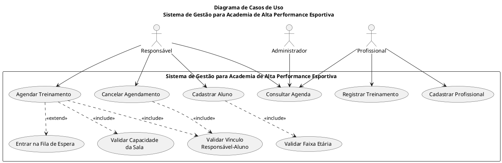

# Documentação dos Casos de Uso

## Sistema de Gestão para Academia de Alta Performance Esportiva

### Versão 2.0 — alinhada à API implementada

---

# 1. UC01 – Agendar Treinamento

## 1.1 Identificação

**ID:** UC01
**Nome:** Agendar Treinamento
**Atores:** Responsável, Sistema

## 1.2 Objetivo

Permitir que o responsável agende um treinamento individual para um aluno vinculado à sua conta, selecionando serviço, profissional, sala, data e horário.

## 1.3 Pré-condições

- O responsável possui uma conta ativa e está autenticado.
- Existe pelo menos um aluno cadastrado e vinculado ao responsável.
- Existe ao menos um serviço no catálogo.

## 1.4 Fluxo Principal

1. O responsável acessa a opção **Agendar Treinamento**.
2. O sistema apresenta os alunos vinculados ao responsável.
3. O responsável seleciona o aluno.
4. O responsável seleciona o serviço, o profissional, a sala e a data/hora desejados.
5. O sistema valida que o aluno é dependente do responsável autenticado.
6. O sistema conta os agendamentos **ativos** para a mesma sala e horário.
7. Se a quantidade for inferior à capacidade da sala, o sistema registra o agendamento com status **"ativo"**.
8. Se a quantidade atingir a capacidade da sala, o sistema registra o agendamento com status **"fila_espera"**.
9. O sistema calcula a posição do aluno na fila de espera conforme a ordem de criação.
10. O sistema confirma a operação e exibe o status ao responsável.

## 1.5 Fluxos Alternativos

### FA1 – Sala lotada (fila de espera)

1. O sistema identifica que a sala atingiu sua capacidade para o horário.
2. O sistema **não recusa** a solicitação: registra o agendamento em fila de espera.
3. O sistema informa ao responsável a posição do aluno na fila.

### FA2 – Aluno não vinculado ao responsável

1. O sistema identifica que o aluno informado não pertence ao responsável autenticado.
2. O sistema nega a operação e informa a falta de permissão.

## 1.6 Pós-condições

- O agendamento é registrado com status **"ativo"** ou **"fila_espera"**.
- Quando em fila de espera, a posição é calculada e retornada.

## 1.7 Regras de Negócio

- Apenas o responsável do aluno pode criar o agendamento.
- O limite de pessoas no mesmo horário é a **capacidade da sala**.
- O excedente entra em fila de espera, ordenada pela data de criação.
- O agendamento deve estar vinculado obrigatoriamente a um serviço.
- A sala é opcional; sem sala informada, não há controle de capacidade.

## 1.8 Relacionamentos

**`<<include>>`**

- Validar vínculo responsável-aluno.
- Verificar capacidade da sala.

**`<<extend>>`**

- Entrar na fila de espera, quando a sala estiver na capacidade.

## 1.9 Requisitos Relacionados

**RF09, RF10, RF11, RF12, RF13 e RF14.**

---

# 2. UC02 – Cancelar Agendamento

## 2.1 Identificação

**ID:** UC02
**Nome:** Cancelar Agendamento
**Atores:** Responsável, Sistema

## 2.2 Objetivo

Permitir que o responsável cancele um agendamento, liberando a capacidade da sala.

## 2.3 Pré-condições

- Existe um agendamento vinculado a um aluno do responsável.
- O responsável está autenticado no sistema.

## 2.4 Fluxo Principal

1. O responsável consulta sua agenda.
2. O sistema apresenta os agendamentos dos dependentes.
3. O responsável seleciona o agendamento que deseja cancelar.
4. O sistema altera o status do agendamento para **"inativo"**.

## 2.5 Pós-condições

- O agendamento cancelado deixa de contar para a capacidade da sala.
- Novos agendamentos no horário podem ocupar a vaga liberada.

## 2.6 Regras de Negócio

- Apenas o responsável do aluno pode cancelar o agendamento.
- O histórico do agendamento permanece no sistema (status inativo), preservando `criado_em`.

## 2.7 Requisitos Relacionados

**RF14 e RF15.**

---

# 3. UC03 – Cadastrar Aluno

## 3.1 Identificação

**ID:** UC03
**Nome:** Cadastrar Aluno
**Atores:** Responsável, Sistema

## 3.2 Objetivo

Permitir que o responsável cadastre um ou mais alunos e os vincule à sua conta.

## 3.3 Pré-condições

- O responsável possui uma conta ativa e está autenticado.

## 3.4 Fluxo Principal

1. O responsável acessa a opção **Cadastrar Aluno**.
2. O responsável informa o nome e a data de nascimento do aluno.
3. O sistema calcula a idade do aluno.
4. O sistema verifica se a idade está entre **7 e 12 anos**.
5. O sistema vincula o aluno à conta do responsável autenticado.
6. O sistema gera a matrícula única do aluno no formato `ALU-<ano>-<código>`.
7. O sistema registra o aluno com status **"ativo"**.

## 3.5 Fluxos Alternativos

### FA1 – Idade fora da faixa permitida

1. O sistema identifica que o aluno possui idade inferior a 7 anos ou superior a 12 anos.
2. O sistema bloqueia o cadastro.
3. O sistema informa que a academia atende exclusivamente crianças de 7 a 12 anos.

## 3.6 Pós-condições

- O aluno é registrado no sistema, vinculado ao responsável e habilitado para agendamentos.

## 3.7 Regras de Negócio

- O aluno deve possuir idade entre **7 e 12 anos**.
- Um responsável pode possuir um ou mais alunos vinculados.
- A matrícula é única e gerada automaticamente pelo sistema.

## 3.8 Requisitos Relacionados

**RF03 e RF04.**

---

# 4. UC04 – Cadastrar Profissional

## 4.1 Identificação

**ID:** UC04
**Nome:** Cadastrar Profissional
**Atores:** Profissional, Sistema

## 4.2 Objetivo

Permitir que um usuário autenticado registre-se como profissional, informando nome e ocupação.

## 4.3 Pré-condições

- O usuário está autenticado e ainda não possui perfil de profissional.

## 4.4 Fluxo Principal

1. O usuário informa o nome e a ocupação (tipo de serviço que oferece).
2. O sistema valida que a ocupação é um dos serviços do catálogo.
3. O sistema verifica que a conta ainda não possui perfil de profissional.
4. O sistema gera o código profissional único no formato `PRO-<ano>-<código>`.
5. O sistema vincula o perfil à conta do usuário.

## 4.5 Fluxos Alternativos

### FA1 – Conta já cadastrada como profissional

1. O sistema identifica que a conta já possui perfil de profissional.
2. O sistema nega a operação e informa a duplicidade.

### FA2 – Usuário responsável

1. Usuários com perfil de responsável veem a lista completa de profissionais para consulta.
2. A criação fica restrita às demais contas.

## 4.6 Pós-condições

- O profissional está cadastrado, com código único e disponibilidade padrão "disponível".

## 4.7 Regras de Negócio

- A ocupação deve ser um dos seis serviços do catálogo.
- Uma conta pode possuir apenas um perfil de profissional.
- Apenas administradores (staff) alteram ou excluem profissionais de terceiros.

## 4.8 Requisitos Relacionados

**RF05.**

---

# 5. UC05 – Registrar Treinamento

## 5.1 Identificação

**ID:** UC05
**Nome:** Registrar Treinamento
**Atores:** Profissional, Sistema

## 5.2 Objetivo

Permitir que o profissional registre a presença ou ausência do aluno e suas observações de avaliação física e técnica após um treinamento.

## 5.3 Pré-condições

- O profissional está autenticado.
- Existe um agendamento correspondente.

## 5.4 Fluxo Principal

1. O profissional informa o agendamento referenciado.
2. O profissional registra a presença ou ausência do aluno.
3. O profissional informa as observações do treinamento.
4. O profissional registra a avaliação física.
5. O profissional registra a avaliação técnica.
6. O sistema valida os dados.
7. O sistema atribui o registro ao profissional autenticado e o vincula ao agendamento.

## 5.5 Fluxos Alternativos

### FA1 – Usuário sem perfil de profissional

1. O sistema identifica que o usuário autenticado não possui perfil de profissional.
2. O sistema nega a criação do registro.

### FA2 – Agendamento já registrado

1. O sistema impede um segundo registro para o mesmo agendamento (relação 1:1).

## 5.6 Pós-condições

- O registro de treinamento está criado e vinculado ao agendamento e ao profissional.
- O responsável pode consultar o registro dos seus dependentes.

## 5.7 Regras de Negócio

- Cada agendamento admite no máximo um registro de treinamento.
- O profissional do registro é sempre o usuário autenticado (não pode ser atribuído a outro).

## 5.8 Classes Relacionadas

- `Profissional`
- `Agendamento`
- `RegistroTreinamento`

## 5.9 Requisitos Relacionados

**RF16, RF17 e RF18.**

---

# 6. UC06 – Consultar Agenda

## 6.1 Identificação

**ID:** UC06
**Nome:** Consultar Agenda
**Atores:** Responsável, Profissional, Sistema

## 6.2 Objetivo

Permitir que usuários autorizados consultem os agendamentos e registros relacionados ao seu perfil.

## 6.3 Pré-condições

- O usuário está autenticado.

## 6.4 Fluxo Principal

### Para o Responsável

1. O responsável acessa a opção **Consultar Agenda**.
2. O sistema identifica os alunos vinculados ao responsável.
3. O sistema apresenta os agendamentos dos dependentes, com serviço, sala, data/hora, status e posição na fila de espera.
4. O responsável pode consultar também os registros de treinamento dos seus dependentes.

### Para o Profissional

1. O profissional acessa a opção **Consultar Agenda**.
2. O sistema apresenta os agendamentos e registros vinculados ao profissional autenticado.

## 6.5 Fluxos Alternativos

### FA1 – Nenhum agendamento encontrado

1. O sistema identifica que não existem agendamentos para o perfil consultado.
2. O sistema retorna lista vazia.

## 6.6 Pós-condições

- O usuário visualiza as informações de sua agenda; nenhum dado é alterado.

## 6.7 Regras de Negócio

- O responsável somente consulta a agenda e os registros dos alunos vinculados à sua conta.
- O profissional somente consulta seus próprios agendamentos e registros.
- Salas e serviços são consultáveis por qualquer usuário autenticado (somente leitura).

## 6.8 Classes Relacionadas

- `Responsavel`
- `Profissional`
- `Aluno`
- `Agendamento`
- `RegistroTreinamento`

## 6.9 Requisitos Relacionados

**RF14 e RF18.**

---

# 7. Tabela de Rastreabilidade dos Casos de Uso

| Caso de Uso                       | Funcionalidade Principal                | Atores                   | Requisitos                          |
| --------------------------------- | ---------------------------------------- | ------------------------ | ----------------------------------- |
| **UC01 – Agendar Treinamento**    | Agendamento individual com fila de espera | Responsável, Sistema     | RF09, RF10, RF11, RF12, RF13, RF14  |
| **UC02 – Cancelar Agendamento**   | Cancelamento e liberação de capacidade   | Responsável, Sistema     | RF14, RF15                          |
| **UC03 – Cadastrar Aluno**        | Cadastro de dependentes                  | Responsável, Sistema     | RF03, RF04                          |
| **UC04 – Cadastrar Profissional** | Autoatendimento do profissional          | Profissional, Sistema    | RF05                                |
| **UC05 – Registrar Treinamento**  | Registro de presença e avaliações        | Profissional, Sistema    | RF16, RF17, RF18                    |
| **UC06 – Consultar Agenda**       | Consulta de agendamentos e registros     | Responsável, Profissional, Sistema | RF14, RF18                |

---

# 8. Resumo dos Atores

## Responsável

Responsável por:

- Criar e acessar sua conta;
- Cadastrar alunos;
- Agendar treinamentos;
- Cancelar agendamentos;
- Consultar a agenda e os registros dos dependentes.

## Profissional

Responsável por:

- Cadastrar o próprio perfil profissional;
- Consultar seus agendamentos;
- Registrar presença, observações e avaliações.

## Administrador (staff)

Responsável por:

- Gerenciar profissionais, salas e serviços;
- Consultar todos os dados do sistema.

# Diagrama de Casos de Uso

