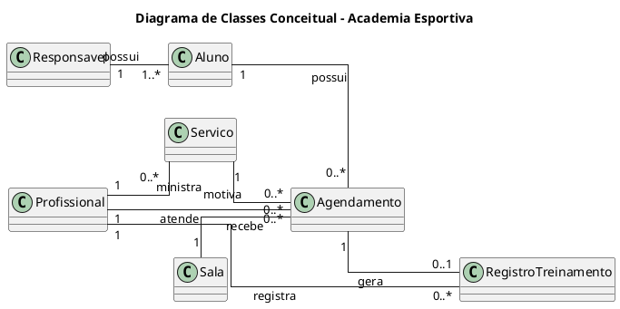
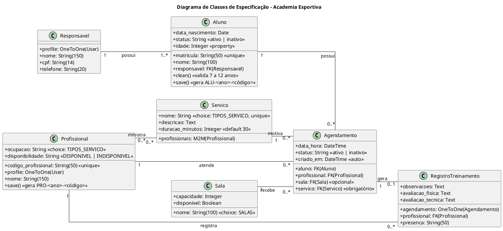

## Diagrama de Classes

### Versão 2.0 — alinhada à implementação

### Objetivo

O Diagrama de Classes é uma representação visual das classes, seus atributos, métodos e os relacionamentos entre elas. Ele é fundamental para a modelagem orientada a objetos e serve como base para a implementação do sistema.

### 1) Diagrama de Classes Conceitual

#### 1.1 Finalidade

Representar os principais conceitos do domínio da academia de alta performance esportiva e os relacionamentos envolvidos no cadastro, agendamento e acompanhamento dos treinamentos.

#### 1.2 Escopo

O modelo contempla as entidades **implementadas** no backend (`app/models.py`):

- **Perfis de acesso:** `Responsavel` e `Profissional`, ambos ligados a uma conta de usuário (`User` do Django) por relacionamento um-para-um;
- **Cadastro:** `Aluno` e `Sala`;
- **Operação:** `Servico`, `Agendamento` e `RegistroTreinamento`.

> **Nota:** as versões anteriores deste documento incluíam as classes `Turma`, `Pagamento`, `FilaEspera`, `Notificacao` e `Administrador`. Essas entidades não foram implementadas: o agendamento é individual por serviço, a fila de espera é representada pelo status do próprio agendamento (e não por uma entidade separada) e não há integração financeira ou de notificações.

#### 1.3 Fonte PlantUML

#### 1.4 Descrição das classes e regras de domínio

| Classe                | Descrição e responsabilidade no domínio                                                                                     |
| --------------------- | ---------------------------------------------------------------------------------------------------------------------------- |
| `Responsavel`         | Pessoa legalmente responsável por um ou mais alunos; cadastra dependentes, agenda e cancela treinamentos e consulta sua evolução. Vinculada a uma conta de usuário. |
| `Profissional`        | Treinador que atende agendamentos e registra presença e avaliações. Possui ocupação (tipo de serviço) e disponibilidade. Vinculado a uma conta de usuário. |
| `Aluno`               | Criança entre 7 e 12 anos, vinculada a um responsável e beneficiária dos agendamentos e registros de treinamento. Matrícula única gerada automaticamente. |
| `Sala`                | Espaço físico com nome e capacidade; a capacidade limita a quantidade de agendamentos ativos no mesmo horário.                |
| `Servico`             | Modalidade de treinamento do catálogo, com descrição, duração e sala correspondente; relaciona-se com profissionais por muitos-para-muitos. |
| `Agendamento`         | Reserva de um treinamento para um aluno, com data/hora, profissional, serviço, sala opcional e status (`ativo` ou `fila_espera`). |
| `RegistroTreinamento` | Registro 1:1 com o agendamento: presença, observações e avaliações física e técnica. Sempre criado pelo profissional.         |

Regras de negócio representadas ou derivadas do código:

- A idade do `Aluno` deve estar entre 7 e 12 anos, validada automaticamente no salvamento.
- A `matricula` do aluno e o `codigo_profissional` são únicos e gerados automaticamente (`ALU-<ano>-<código>` e `PRO-<ano>-<código>`).
- A `ocupacao` do `Profissional` deve ser um dos serviços do catálogo.
- Todo `Agendamento` está vinculado obrigatoriamente a um `Servico`.
- Quando a capacidade da `Sala` no horário é atingida, o agendamento recebe status `fila_espera` e posição calculada pela ordem de criação.
- Cada `Agendamento` gera no máximo um `RegistroTreinamento`, criado pelo profissional.

#### 1.5 Rastreabilidade

| Classe Conceitual     | Requisito(s)                   | Caso(s) de Uso         |
| --------------------- | ------------------------------- | ----------------------- |
| `Responsavel`         | RF01–RF04, RF09, RF14, RF15     | UC01, UC02, UC03, UC06  |
| `Profissional`        | RF05, RF08, RF16, RF17          | UC04, UC05, UC06        |
| `Aluno`               | RF03, RF04, RF09, RF14          | UC01, UC03, UC06        |
| `Sala`                | RF06, RF10, RF11                | UC01                    |
| `Servico`             | RF07, RF08, RF09                | UC01                    |
| `Agendamento`         | RF09–RF15                       | UC01, UC02, UC06        |
| `RegistroTreinamento` | RF16, RF17, RF18                | UC05, UC06              |

### 2) Diagrama de Classes de Especificação

#### 2.1 Objetivo

Refinar o modelo conceitual com os atributos, tipos e operações exatamente como implementados no código.

#### 2.2 Fonte PlantUML

#### 2.3 Invariantes implementadas

- `Aluno.idade` deve estar entre 7 e 12 anos; caso contrário o salvamento falha (`clean()`).
- `Aluno.matricula` e `Profissional.codigo_profissional` são únicos e gerados no primeiro salvamento.
- `Responsavel.profile` e `Profissional.profile` referenciam a mesma conta de usuário por relações um-para-um distintas (`perfil_responsavel` e `profile_profissional`).
- O limite do `Agendamento` por sala/horário é aplicado na camada da API (`AgendamentoSerializer.validate`), comparando agendamentos ativos com `Sala.capacidade`.
- A posição na fila de espera (`posicao_fila`) é calculada pela contagem de agendamentos em `fila_espera` criados anteriormente para a mesma sala e horário.

#### 2.4 Critérios de qualidade

- Os nomes das classes e atributos correspondem literalmente ao código-fonte.
- Todas as classes possuem responsabilidade e rastreabilidade identificadas.
- As relações mantêm as multiplicidades implementadas.

## Versionamento

| Versão | Data       | Autor(es)        | Descrição                                                                                                    |
| ------ | ---------- | ---------------- | -------------------------------------------------------------------------------------------------------------- |
| v0.1   | 23/09/2026 | Victor Coutinho  | Documentação dos diagramas conceitual e de especificação.                                                     |
| v2.0   | 13/11/2026 | Ricardo Costa    | Reescrita alinhada ao código: removidas `Turma`, `Pagamento`, `FilaEspera` e `Notificacao`; adicionados `Servico` e fila de espera como status do agendamento. |
