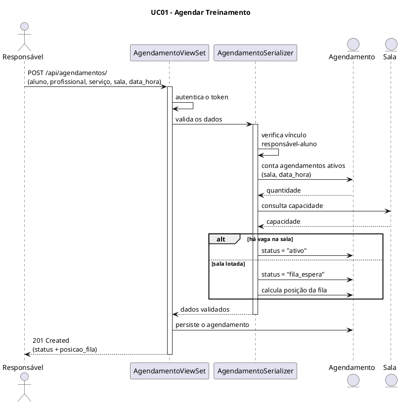

### Diagrama de Sequência

O Diagrama de Sequência é uma representação visual que mostra a interação entre objetos ou componentes ao longo do tempo. Ele é usado para modelar o comportamento dinâmico de um sistema, ilustrando como os objetos colaboram para realizar uma funcionalidade específica.

#### Objetivo

Definir um padrão para elaboração e registro dos Diagramas de Sequência, garantindo rastreabilidade com:

- Casos de Uso
- Diagrama de Casos de Uso
- Documento de Levantamento de Requisitos

#### Diagrama — UC01: Agendar Treinamento

##### 1. Identificação

- **Caso de Uso:** Agendar Treinamento
- **ID do Caso de Uso:** UC01
- **Ator(es):** Responsável
- **Prioridade:** Alta
- **Data:** 13/11/2026

##### 2. Referências

- **Requisitos relacionados (ID):** RF09, RF10, RF11, RF12, RF13
- **Regra(s) de negócio associada(s):** capacidade da sala como limite por horário; fila de espera automática; vínculo responsável-aluno obrigatório.

##### 3. Cenário Modelado

- **Objetivo do cenário:** registrar um agendamento de treinamento para um dependente do responsável autenticado, aplicando o controle de capacidade da sala.
- **Pré-condições:** responsável autenticado com token; aluno vinculado ao responsável; sala com capacidade cadastrada.
- **Pós-condições:** agendamento persistido com status `ativo` ou `fila_espera`.
- **Gatilho de início:** requisição `POST /api/agendamentos/`.

##### 4. Participantes (Lifelines)

- **Ator:** Responsável
- **Boundary/View (API):** `AgendamentoViewSet`
- **Control (Validação):** `AgendamentoSerializer.validate`
- **Entity (Dados):** `Agendamento`, `Sala`

##### 5. Fluxo Principal (mensagens)

| Passo | Remetente | Destinatário | Mensagem/Ação | Tipo |
|------:|-----------|--------------|---------------|------|
| 1 | Responsável | AgendamentoViewSet | POST /api/agendamentos/ (aluno, profissional, serviço, sala, data_hora) | sync |
| 2 | AgendamentoViewSet | Autenticação DRF | valida o token do usuário | sync |
| 3 | AgendamentoViewSet | AgendamentoSerializer | serializa e valida os dados | sync |
| 4 | AgendamentoSerializer | Responsável (request.user) | verifica o vínculo do aluno com o responsável autenticado | sync |
| 5 | AgendamentoSerializer | Agendamento | conta agendamentos com status "ativo" para a mesma sala e data_hora | sync |
| 6 | AgendamentoSerializer | Sala | compara a contagem com a capacidade da sala | sync |
| 7 | AgendamentoSerializer | Agendamento | define status: "ativo" (há vaga) ou "fila_espera" (lotada) | sync |
| 8 | AgendamentoViewSet | Agendamento | persiste o agendamento | sync |
| 9 | AgendamentoSerializer | AgendamentoViewSet | calcula posicao_fila, se em fila de espera | sync |
| 10 | AgendamentoViewSet | Responsável | retorna 201 com os dados do agendamento | retorno |

##### 6. Fluxos Alternativos e Exceções

| ID | Condição | Descrição do fluxo | Impacto |
|----|----------|--------------------|---------|
| A1 | Sala atingiu a capacidade no horário | Agendamento registrado com status `fila_espera` | Posição na fila calculada pela ordem de criação |
| E1 | Aluno não pertence ao responsável autenticado | `perform_create` nega a operação | 403 — "Você não tem permissão para agendar treinos para este aluno" |
| E2 | Usuário não é responsável (sem perfil) | `perform_create` nega a operação | 403 — "Apenas responsáveis podem fazer agendamentos" |
| E3 | Sala ou horário não informados | Validação ignora o controle de capacidade | Agendamento criado sem fila de espera |

##### 7. Regras de Negócio Aplicadas

- **RN-01:** o limite de agendamentos ativos por sala e horário é a capacidade cadastrada da sala.
- **RN-02:** excedentes entram em fila de espera, com posição pela ordem de criação.
- **RN-03:** somente o responsável do aluno pode criar o agendamento.

##### 8. Pontos de Validação

- [x] Fluxo compatível com o Caso de Uso UC01
- [x] Mensagens consistentes com os requisitos funcionais
- [x] Alternativas/exceções representadas
- [x] Participantes aderentes à arquitetura (ViewSet + Serializer + Models)

##### 9. Artefatos

- **Arquivo fonte (PlantUML):** incluído acima
- **Versão:** 2.0
