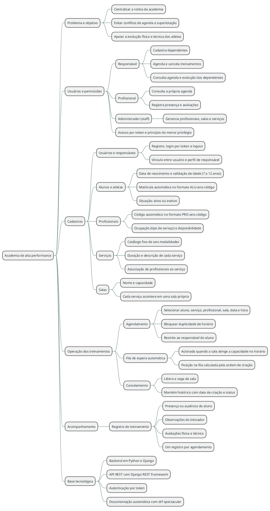

## Introdução

Mapa mental consiste em criar resumos cheios de símbolos, cores, setas e frases de efeito com o objetivo de organizar o conteúdo e facilitar associações entre as informações destacadas. Esse material é muito indicado para pessoas que têm facilidade de aprender de forma visual.

 
## Metodologia

O mapa foi elaborado a partir da consolidação das ideias levantadas no <a href="Brainstorm.md">Brainstorm</a>, no <a href="5w2h.md">5W2H</a> e no <a href="design_thinking.md">Design Thinking</a>, e atualizado para refletir o sistema implementado. O tema central representa o sistema e seus ramos organizam o problema, os usuários, os cadastros, a operação, o acompanhamento e a base tecnológica. O diagrama foi escrito em PlantUML para permanecer versionável e fácil de atualizar durante as próximas iterações.

 
## Mapa mental geral
 
### Versão 2.0

O centro do mapa é o **Sistema para academia de alta performance**. A leitura parte do centro e segue os ramos para compreender:

- **Problema e objetivo:** por que o sistema é necessário e quais resultados deve apoiar;
- **Usuários e permissões:** quem utiliza a solução e quais informações cada perfil pode acessar;
- **Cadastros:** entidades implementadas no backend;
- **Operação dos treinamentos:** como o agendamento, a fila de espera e o cancelamento funcionam;
- **Acompanhamento:** como registrar a rotina dos atletas;
- **Base tecnológica:** quais decisões orientam o backend.

## Evoluções descartadas nesta versão

Nas versões anteriores do mapa apareciam os ramos de **turmas**, **pagamentos** e **notificações**. Essas capacidades não fazem parte do sistema implementado: o agendamento é individual por serviço, o controle de lotação é feito pela capacidade da sala (com fila de espera automática integrada ao agendamento) e não há integração financeira.

## Conclusão

O mapa organiza a proposta do projeto em uma visão única: a academia precisa de uma fonte confiável para gerenciar responsáveis, atletas, profissionais, serviços, salas e treinamentos. O núcleo implementado está no vínculo entre responsável e aluno, no agendamento individual com validação de idade e capacidade da sala e na fila de espera automática. Os demais ramos mostram capacidades que podem ser desenvolvidas de forma incremental.

 
## Referências

- [Brainstorm](Brainstorm.md)
- [5W2H](5w2h.md)
- [Design Thinking](design_thinking.md)
- [Documentação do PlantUML](https://plantuml.com/mindmap-diagram)

## Versionamento

| Data       | Versão | Descrição                                                                        | Autor(es)     |
| ---------- | ------ | -------------------------------------------------------------------------------- | ------------- |
| 13/09/2026 | 1.0    | Criação do mapa mental geral da proposta do sistema.                             | Luiz Fernando |
| 13/11/2026 | 2.0    | Atualização para refletir o código implementado (sem turmas, pagamentos e notificações). | Ricardo Costa |
