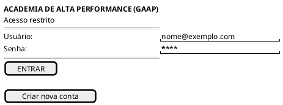
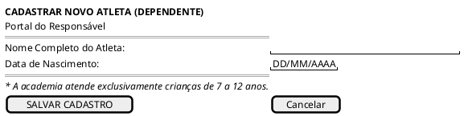
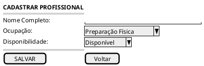
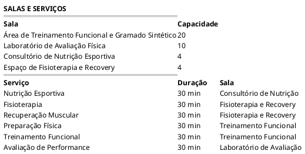
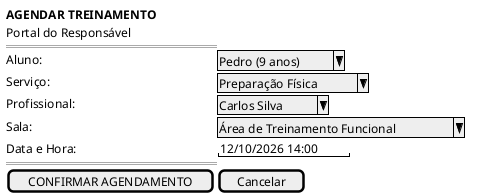
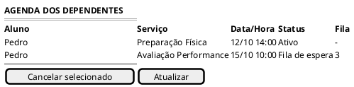
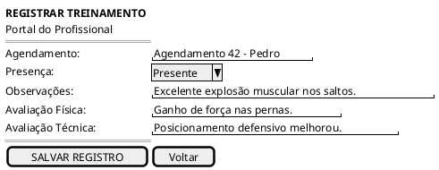

## Introdução

O protótipo de baixa fidelidade representa, de forma rápida e objetiva, as principais interfaces do sistema de gestão da academia de alta performance esportiva. As telas foram elaboradas em PlantUML com a sintaxe Salt, priorizando a organização dos campos, ações e informações necessárias para validar os fluxos antes da implementação visual definitiva.

## Metodologia

As interfaces refletem os endpoints implementados na API do projeto: autenticação, cadastro de responsável e aluno, agendamento individual de treinamentos com fila de espera por sala e registro de treinamento pelo profissional. Cada protótipo identifica o perfil que utiliza a tela e o fluxo principal representado.

## Protótipos de baixa fidelidade

### Versão 2.0

## 1. Interface de Login e Acesso

**Perfil:** Responsável e Profissional

Esta tela representa a porta de entrada do sistema. Ela permite autenticação por token, criação de conta e encerramento da sessão.

**Relação com o código:** a autenticação utiliza token (`POST /api/auth/token/`), a criação de conta é pública (`POST /api/auth/register/`) e o logout invalida o token (`POST /api/auth/logout/`). Toda a API exige usuário autenticado.

## 2. Cadastro de Aluno / Atleta

**Perfil:** Responsável

O responsável utiliza esta interface para cadastrar uma criança vinculada à própria conta. A data de nascimento é validada automaticamente: a academia atende exclusivamente crianças de 7 a 12 anos.

**Relação com o código:** corresponde ao `POST /api/alunos/`. O responsável é atribuído automaticamente a partir da conta autenticada e a matrícula é gerada pelo sistema no formato `ALU-<ano>-<código>`. Cadastros fora da faixa etária são rejeitados.

## 3. Cadastro de Profissional

**Perfil:** Profissional (autoatendimento, aprovado pela administração)

O profissional se cadastra informando nome e ocupação (tipo de serviço). O sistema gera um código profissional único e impede cadastro duplicado da mesma conta.

**Relação com o código:** corresponde ao `POST /api/profissionais/`. O campo de ocupação aceita os seis tipos de serviço do catálogo. A conta não pode possuir mais de um perfil de profissional.

## 4. Consulta de Salas e Serviços

**Perfil:** Qualquer usuário autenticado

Lista das salas disponíveis com capacidade e dos serviços do catálogo, indicando a sala em que cada serviço acontece.

**Relação com o código:** corresponde a `GET /api/salas/` e `GET /api/servicos/`. A escrita dessas entidades é feita pela administração (usuários staff).

## 5. Agendamento de Treinamento

**Perfil:** Responsável

O responsável seleciona o aluno, o serviço, o profissional, a sala e a data/hora. Se a sala já atingiu a capacidade no horário, o agendamento entra automaticamente em fila de espera.

**Estados do agendamento:**

- **Ativo:** havia vagas na sala no horário; o treino está confirmado.
- **Fila de espera:** a sala atingiu a capacidade; o sistema informa a posição do aluno na fila.

**Relação com o código:** corresponde ao `POST /api/agendamentos/`. Apenas o responsável do aluno pode agendar. O sistema conta os agendamentos ativos para a mesma sala e horário e compara com a capacidade da sala.

## 6. Consulta da Agenda e da Fila de Espera

**Perfil:** Responsável

O responsável consulta os agendamentos dos dependentes, incluindo status e posição na fila de espera.

**Relação com o código:** corresponde a `GET /api/agendamentos/` e `DELETE/PATCH /api/agendamentos/{id}/`. A lista mostra somente agendamentos dos alunos vinculados ao responsável autenticado. O campo de fila é calculado pela ordem de criação dos agendamentos em espera.

## 7. Registro de Treinamento (Profissional)

**Perfil:** Profissional

Após o treinamento, o profissional registra a presença do aluno, observações e as avaliações física e técnica. Cada agendamento admite um único registro.

**Relação com o código:** corresponde a `POST /api/registros/`. Apenas usuários com perfil de profissional podem criar registros; o profissional é atribuído automaticamente a partir da conta autenticada. O responsável consulta os registros somente dos seus dependentes.

## Conclusão

Os protótipos representam os fluxos implementados na API atual: autenticação por token, cadastro de dependente com validação de idade, cadastro de profissional, consulta de salas e serviços, agendamento individual com fila de espera por sala e registro de treinamento pelo profissional. As versões anteriores deste documento, baseadas em turmas, painel administrativo e pagamentos, foram substituídas para manter a documentação alinhada ao código.

## Referências

- [Levantamento de Requisitos e Caso de Uso](../Elaboracao/levreq.md)
- [Documentação do PlantUML Salt](https://plantuml.com/salt)

## Autor(es)

| Data       | Versão | Descrição                                                                     | Autor(es)     |
| ---------- | ------ | ----------------------------------------------------------------------------- | ------------- |
| 23/09/2026 | 1.0    | Criação dos protótipos de baixa fidelidade.                                   | Luiz Fernando |
| 13/11/2026 | 2.0    | Reescrita dos protótipos para refletir os endpoints implementados na API.     | Ricardo Costa |
